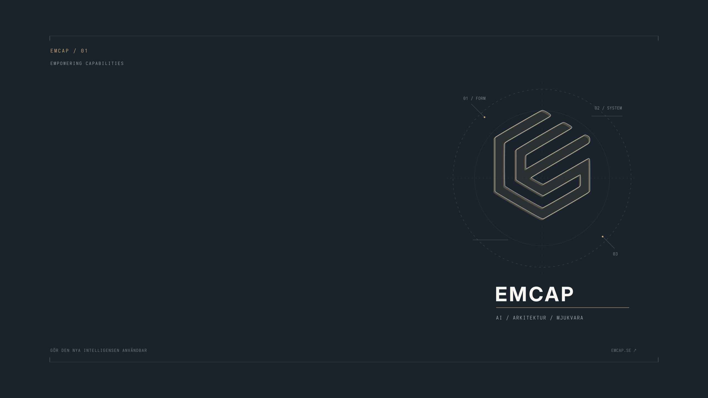

# Emcap Sketch for Omarchy

A quiet, ink-and-paper desktop theme inspired by [Emcap](https://emcap.se). The gold geometric mark is presented as a technical pencil sketch, with drafting guides and small labels for **AI, architecture, and software**. The rest of the desktop stays dark and readable.



## Palette and type

| Role | Color |
| --- | --- |
| Ink | `#1a232c` |
| Paper | `#f7f6f2` |
| Emcap gold | `#caa977` |
| Slate | `#455060` |

Terminal text uses **Adwaita Mono** at 12 pt; notifications use **Adwaita Sans**. Both are native OS fonts. The theme does not require a separate font download.

## Install

Copy this directory into your local Omarchy themes under the name `emcap-sketch`, then select it:

```bash
mkdir -p ~/.config/omarchy/themes
cp -r omarchy-drac-theme-main ~/.config/omarchy/themes/emcap-sketch
omarchy theme set emcap-sketch
```

Run the commands from the parent directory of this repository. The `colors.toml` is the source of truth for current Omarchy releases; Omarchy generates several app configs from it when installing a cloned theme. The other files keep the original theme's legacy component layout in the same palette.

The scalable wallpaper source is at `artwork/wallpaper.svg`; `backgrounds/01.png` is the ready-to-use 2560 × 1440 rendering. The original Dracula backgrounds and previews were removed so cycling backgrounds stays within this design.

## Credits

Based on the Omarchy Drac theme by Shehab Shaef, retained under the original [MIT license](LICENSE). Emcap's published colors and mark informed this personal theme adaptation; Emcap owns its brand identity.
